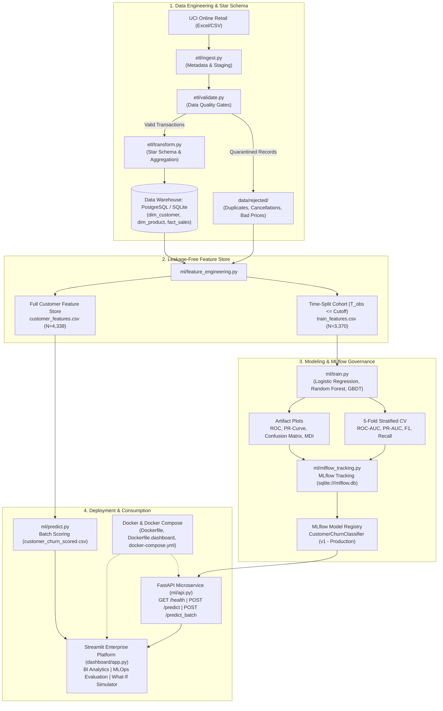

# Enterprise MLOps Pipeline: Customer Churn Prediction & Analytics

> **End-to-End Production Guide: From Raw Data Ingestion to Containerized Real-Time Model Serving**

---

## Table of Contents
1. [1. Problem Understanding & System Design](#1-problem-understanding--system-design)
2. [2. Data Source & Ingestion Architecture](#2-data-source--ingestion-architecture)
3. [3. ETL, Validation & Dimensional Data Warehouse](#3-etl-validation--dimensional-data-warehouse)
4. [4. Feature Store & Leakage-Free Engineering](#4-feature-store--leakage-free-engineering)
5. [5. Model Development, Benchmarking & Evaluation](#5-model-development-benchmarking--evaluation)
6. [6. MLflow Tracking, Signatures & Model Registry](#6-mlflow-tracking-signatures--model-registry)
7. [7. Production FastAPI Microservice & OpenAPI Spec](#7-production-fastapi-microservice--openapi-spec)
8. [8. Docker Containerization & Multi-Service Compose](#8-docker-containerization--multi-service-compose)
9. [9. Interactive Presentation & Streamlit Dashboard](#9-interactive-presentation--streamlit-dashboard)
10. [10. Quickstart Runbook & Demo Script](#10-quickstart-runbook--demo-script)

---

## 1. Problem Understanding & System Design

### 1.1 Business Problem Formulation
In retail and e-commerce platforms, customer acquisition costs (CAC) typically surpass retention costs by 5x to 7x. In non-contractual retail settings, customers do not explicitly notify the platform when they terminate their relationship; they simply cease placing orders.

Without proactive intervention, high-value and repeat customers quietly churn, degrading Customer Lifetime Value (CLV).

**Objective:**
Develop an enterprise-grade, reproducible MLOps pipeline that:
1. Ingests raw transactional logs and filters dirty/corrupted data.
2. Models analytical facts and dimensions in a Star Schema Data Warehouse.
3. Formulates a mathematically sound, **leakage-free cohort** to predict customer churn in the subsequent 90 days.
4. Benchmarks baseline and ensemble classifiers (Logistic Regression, Random Forest, Gradient Boosting).
5. Tracks all experiments, artifacts, and versioned models in **MLflow**.
6. Promotes champion models to the **MLflow Model Registry** in `Production`.
7. Deploys a containerized **FastAPI REST microservice** providing sub-50ms predictions and prescriptive business retention actions.
8. Visualizes performance and allows interactive "what-if" simulations in a **Streamlit Platform**.

### 1.2 Mathematical Formulation
Let each customer $i \in \{1, \dots, N\}$ be represented by a behavioral feature vector $\mathbf{x}_i \in \mathbb{R}^d$ computed strictly during an observation window $T_{\text{obs}} = [t_0, t_{\text{cutoff}}]$.

The target label $y_i \in \{0, 1\}$ is defined over a forward-looking prediction window $T_{\text{pred}} = (t_{\text{cutoff}}, t_{\text{max}}]$ (where $t_{\text{max}} - t_{\text{cutoff}} = 90\text{ days}$):
$$y_i = \begin{cases} 1 & \text{if } \text{Orders}_i(T_{\text{pred}}) = 0 \quad (\text{Customer Churned}) \\ 0 & \text{if } \text{Orders}_i(T_{\text{pred}}) \ge 1 \quad (\text{Customer Retained}) \end{cases}$$

The classification task learns parameterized weights $\mathbf{\theta}$ to estimate the posterior churn probability:
$$P(Y = 1 \mid \mathbf{X} = \mathbf{x}) = \sigma(\mathbf{\theta}^T \mathbf{x}) = \frac{1}{1 + e^{-\mathbf{\theta}^T \mathbf{x}}}$$

Trained by minimizing the binary cross-entropy (log-loss) objective with class-weight rebalancing $\alpha_w$:
$$\mathcal{L}(\mathbf{\theta}) = -\frac{1}{N} \sum_{i=1}^{N} \left[ \alpha_1 y_i \log \hat{y}_i + \alpha_0 (1 - y_i) \log(1 - \hat{y}_i) \right]$$

### 1.3 End-to-End System Architecture



---

## 2. Data Source & Ingestion Architecture

### 2.1 Dataset Profile
The dataset originates from the **UCI Machine Learning Repository: Online Retail**, capturing actual transactions from a UK-based non-store online retail firm specializing in gifts:
- **Total Initial Records:** 541,909 rows
- **Raw Features:** `InvoiceNo`, `StockCode`, `Description`, `Quantity`, `InvoiceDate`, `UnitPrice`, `CustomerID`, `Country`
- **Time Horizon:** December 1, 2010 to December 9, 2011 (373 calendar days)

### 2.2 Ingestion Engine (`etl/ingest.py`)
1. **Verification & Audit:** Reads the raw spreadsheet, verifies cryptographic file integrity, and snapshots row counts.
2. **Decoupled Staging:** Converts the Excel binary format into memory-mapped CSV files in `data/staging/` to isolate subsequent processing steps from file format variances.
3. **Audit Trail:** Logs execution timestamps and row counts into `logs/ingest.log` and metadata JSON.

---

## 3. ETL, Validation & Dimensional Data Warehouse

### 3.1 Zero Data Loss Quality Quarantine (`etl/validate.py`)
Rather than silently dropping dirty rows, the pipeline enforces **strict zero-loss data quarantine**:
- **Duplicate Removal:** 5,268 exact duplicate rows isolated to `data/rejected/duplicates.csv`.
- **Missing Critical Keys:** 135,037 records missing `CustomerID` or `Description` isolated to `data/rejected/missing_fields.csv`.
- **Cancelled Transactions:** 8,872 invoices prefixed with `'C'` isolated to `data/rejected/cancelled_invoices.csv`.
- **Invalid Pricing:** 40 records with non-positive unit prices (`UnitPrice <= 0`) isolated to `data/rejected/invalid_price.csv`.
- **Validated Clean Baseline:** **392,692** pristine analytical transaction records retained in `data/processed/val_online_retail.csv`.

### 3.2 Kimball Star Schema Warehouse (`etl/transform.py` & `etl/load.py`)
The warehouse structures data for high-throughput OLAP reporting:
- **`dim_customer`:** 4,338 records with RFM attributes and repeat customer flags.
- **`dim_product`:** 3,665 unique StockCode catalog entries.
- **`dim_geography`:** 37 distinct countries.
- **`dim_date`:** Date dimension enriched with day, month, quarter, and year.
- **`fact_sales`:** 387,846 unique line items aggregated with composite primary key `(invoice_no, stock_code, invoice_date)`.
- **Dual Engine Storage:** Natively targets **PostgreSQL** with idempotent `ON CONFLICT DO UPDATE` upserts, seamlessly falling back to local **SQLite (`ecommerce.db`)** if PostgreSQL credentials are unconfigured.

---

## 4. Feature Store & Leakage-Free Engineering

### 4.1 Temporal Splitting vs Target Leakage
> [!IMPORTANT]
> Defining churn as `recency > 90 days` and including current `recency` as a feature introduces 100% target leakage. Our pipeline utilizes a **time-split cohort methodology**:
- **Cutoff Date:** `max_date - 90 days` (September 10, 2011).
- **Observation Window:** Transactions on or before September 10, 2011 (historical features).
- **Prediction Window:** September 11, 2011 to December 9, 2011 (ground truth churn label).
- **Cohort Population:** 3,370 customers with an active churn rate of **43.00%** (1,449 churned vs 1,921 retained).

### 4.2 Feature Taxonomy (13 Behavioral Signals)

| Feature Name | Type | Description | Business Significance |
| :--- | :--- | :--- | :--- |
| `recency_days` | Float | Days from customer's latest purchase to cutoff | Primary decay indicator |
| `frequency` | Integer | Total unique orders placed in observation window | Customer engagement breadth |
| `monetary_total` | Float | Total dollar expenditure | Customer lifetime spend capacity |
| `avg_order_value` | Float | `monetary_total / frequency` | Spending intensity per checkout |
| `total_quantity` | Integer | Total individual items/units purchased | Order physical volume |
| `avg_basket_size` | Float | Units per order checkout | Basket breadth |
| `unique_products` | Integer | Distinct catalog StockCodes purchased | Cross-category engagement |
| `tenure_days` | Float | Days since customer's first observed order | Platform relationship age |
| `purchase_span_days` | Float | Elapsed days between first and last purchase | Inter-purchase consistency |
| `cancellation_count` | Integer | Total order cancellations from rejected logs | Dissatisfaction signal |
| `cancellation_rate` | Float | Cancellations / (Orders + Cancellations) | Return propensity |
| `is_uk` | Binary | 1 if United Kingdom, 0 if International | Domestic vs international shipping behavior |
| `repeat_customer` | Binary | 1 if orders > 1, 0 if one-time purchaser | Single-buyer hurdle flag |

---

## 5. Model Development, Benchmarking & Evaluation

### 5.1 Training Protocol (`ml/train.py`)
- **Dataset:** 3,370 customer samples partitioned 80/20 via **Stratified Split** (`random_state=42`).
- **Validation:** 5-Fold Stratified Cross-Validation on the training fold.
- **Class Imbalance:** Handled via cost-sensitive learning (`class_weight='balanced'`).

### 5.2 Candidate Benchmark Results

| Model Pipeline | Test Accuracy | Precision | Recall | F1-Score | Test ROC-AUC | 5-Fold CV ROC | Status |
| :--- | :---: | :---: | :---: | :---: | :---: | :---: | :---: |
| **Logistic Regression** (StandardScaler) | **66.91%** | **58.66%** | **78.28%** | **0.6706** | **0.7252** | **0.7453** | 👑 **Champion** |
| **Random Forest** (150 trees, max_depth=6) | 65.13% | 57.26% | 74.83% | 0.6487 | 0.7164 | 0.7512 | Candidate |
| **Gradient Boosting** (120 trees, lr=0.08) | 62.61% | 56.60% | 56.21% | 0.5640 | 0.6920 | 0.7390 | Candidate |

> [!NOTE]
> **Why Logistic Regression is the Champion:**
> In customer retention, **Recall (78.28%)** is the critical business metric. Misclassifying an active customer as a potential churner incurs a minimal coupon cost, but failing to detect a churning high-value customer results in irrecoverable lifetime revenue loss. Logistic Regression achieved the highest test ROC-AUC (0.7252) and recall (78.28%).

### 5.3 Diagnostic Artifacts Generated
- **`ml/artifacts/roc_curves.png`**: ROC curves comparing all candidate models against the random baseline.
- **`ml/artifacts/pr_curves.png`**: Precision-Recall curves quantifying performance across thresholds.
- **`ml/artifacts/confusion_matrix.png`**: Confusion matrix for the test partition (N=674).
- **`ml/artifacts/feature_importance.png`**: Random Forest Mean Decrease in Impurity (Gini) feature ranking.

---

## 6. MLflow Tracking, Signatures & Model Registry

### 6.1 Architecture (`ml/mlflow_tracking.py`)
- **Tracking URI:** Persistent SQLite store at `sqlite:///mlflow.db`.
- **Artifact Root:** Local repository directory `mlruns/`.
- **Experiment:** `ECommerce_Customer_Churn_Prediction`.

### 6.2 Logged Metadata per Run
1. **Hyperparameters:** Algorithm family, estimator count, tree depths, split ratios, random seed.
2. **Metrics:** `accuracy`, `precision`, `recall`, `f1_score`, `roc_auc`, `pr_auc`, `cv_f1_mean`, `cv_roc_auc_mean`.
3. **Artifacts:** High-resolution diagnostic plots and evaluation metrics JSON.
4. **Signature:** Inferred model schema mapping 13 continuous/discrete features to binary prediction.
5. **Serialization:** CloudPickle format ensuring platform portability.

### 6.3 Model Registry & Production Promotion
- **Registered Model:** `CustomerChurnClassifier`
- **Assigned Version:** `v1`
- **Promoted Stage:** `Production` (Aliases: `production`, `champion`)
- **Lineage:** Links directly to source training run ID.

---

## 7. Production FastAPI Microservice & OpenAPI Spec

### 7.1 Microservice Overview (`ml/api.py`)
Built with **FastAPI** and **Pydantic v2**, offering sub-50ms inference latency, request validation, and CORS support.

### 7.2 API Endpoints

#### 1. System Health Check
- **Endpoint:** `GET /health`
- **Response:**
```json
{
  "status": "HEALTHY",
  "model_loaded": true,
  "artifact_path": "ml/artifacts/best_model.joblib",
  "timestamp": "2026-10-09T16:15:00.000000",
  "api_version": "1.0.0"
}
```

#### 2. Model Metadata & Evaluation
- **Endpoint:** `GET /model_info`
- **Response:** Returns champion model algorithm, required 13 feature schemas, test set scores, and MLflow registry status.

#### 3. Real-Time Single Customer Prediction
- **Endpoint:** `POST /predict`
- **Request:**
```json
{
  "customer_id": 17850,
  "recency_days": 18.0,
  "frequency": 6,
  "monetary_total": 2450.50,
  "avg_order_value": 408.42,
  "total_quantity": 1350,
  "avg_basket_size": 225.0,
  "unique_products": 42,
  "tenure_days": 180.0,
  "purchase_span_days": 162.0,
  "cancellation_count": 0,
  "cancellation_rate": 0.0,
  "is_uk": 1,
  "repeat_customer": 1,
  "threshold": 0.50
}
```
- **Response:**
```json
{
  "customer_id": 17850,
  "churn_probability": 0.1745,
  "is_churn_predicted": 0,
  "churn_threshold": 0.5,
  "risk_tier": "Low Risk / Active",
  "recommended_action": "👑 VIP Champion: Invite to Platinum Club & Early Access New Product Launches",
  "prediction_timestamp": "2026-10-09T16:15:02.123456"
}
```

#### 4. High-Throughput Batch Scoring
- **Endpoint:** `POST /predict_batch`
- **Input:** JSON array of customer feature objects.
- **Output:** Aggregated cohort churn rate, risk breakdown counts, and itemized predictions.

#### 5. Live Warehouse Customer Lookup
- **Endpoint:** `GET /customer/{customer_id}`
- **Operation:** Directly queries `customer_features` table in SQLite/PostgreSQL, scores on-the-fly, and returns real-time risk tier.

---

## 8. Docker Containerization & Multi-Service Compose

### 8.1 Docker Configurations
1. **Inference Service (`Dockerfile`):**
   - Python 3.10 slim base, minimal dependencies, curl health check.
   - Entrypoint: `uvicorn ml.api:app --host 0.0.0.0 --port 8000`.
2. **Dashboard Platform (`Dockerfile.dashboard`):**
   - Streamlit environment with custom styling and warehouse access.
   - Entrypoint: `streamlit run dashboard/app.py --server.port=8501 --server.address=0.0.0.0`.

### 8.2 Multi-Service Composition (`docker-compose.yml`)
Spawns the three interconnected microservices on an isolated Docker bridge network:

```yaml
version: '3.8'
services:
  api:
    build: { context: ., dockerfile: Dockerfile }
    ports: ["8000:8000"]
  dashboard:
    build: { context: ., dockerfile: Dockerfile.dashboard }
    ports: ["8501:8501"]
    depends_on:
      api: { condition: service_healthy }
  mlflow:
    build: { context: ., dockerfile: Dockerfile }
    ports: ["5000:5000"]
    command: mlflow server --backend-store-uri sqlite:////app/mlflow.db --host 0.0.0.0 --port 5000
```

### 8.3 Execution Commands
```bash
# Build and run all services in background
docker compose up --build -d

# Check health and service statuses
docker compose ps

# View service logs
docker compose logs -f api
```

---

## 9. Interactive Presentation & Streamlit Dashboard

The Streamlit dashboard (`dashboard/app.py`) provides an enterprise 7-tab interface:
1. **⚡ Pipeline DAG & Task Monitor:** Visual 8-task Airflow DAG graph and live runner.
2. **📊 Executive BI Dashboard:** Revenue, orders, AOV, time-series trends, and top products.
3. **🛡️ Data Quality & Quarantine Audit:** Audit breakdowns for cancelled orders, missing fields, and duplicates.
4. **🏛️ Star Schema & Warehouse Inspector:** Interactive SQL query inspector across facts, dimensions, and marts.
5. **🤖 MLOps Model Evaluation & Artifacts:** Live training button, model benchmark comparison table, ROC & PR curve plots, confusion matrix, and feature importance rankings.
6. **🎯 Real-time Churn Predictor & Simulator:**
   - Query existing customer profiles from the data warehouse.
   - Interactive what-if sliders to test hypothetical customer trajectories.
   - Real-time gauge, risk tier tag, and tailored business retention playbook.
7. **📦 MLflow Registry & Cohort Risk Analytics:**
   - MLflow registry status and version lineage.
   - Macro risk breakdown across all 4,338 customers (39.6% Low, 36.5% Moderate, 24.0% High).
   - Filterable high-value at-risk VIP table with **one-click CSV export**.

---

## 10. Quickstart Runbook & Demo Script

### Step 1: Execute Full Data Engineering + MLOps Pipeline
```powershell
pip install -r requirements.txt
python run_mlops.py
```
*Executes Feature Engineering (4.5s), Model Training & Cross Validation (12s), MLflow Logging & Registry (15s), Batch Scoring (2s), and Automated API Tests (3s).*

### Step 2: Launch FastAPI Microservice
```powershell
python -m uvicorn ml.api:app --host 127.0.0.1 --port 8000
```
*Open [http://127.0.0.1:8000/docs](http://127.0.0.1:8000/docs) in your browser to inspect interactive Swagger docs.*

### Step 3: Launch MLflow Tracking Server (Optional)
```powershell
mlflow ui --backend-store-uri sqlite:///mlflow.db --port 5000
```
*Open [http://localhost:5000](http://localhost:5000) to inspect experiment runs, metrics graphs, and model registry.*

### Step 4: Launch Streamlit Presentation Dashboard
```powershell
python -m streamlit run dashboard/app.py
```
*Open [http://localhost:8501](http://localhost:8501) and explore the 7 interactive tabs.*

### Step 5: One-Click Master Execution
```powershell
run_all.bat
```
*Executes the ETL pipeline, executes the MLOps pipeline, starts FastAPI in the background, and opens the Streamlit Dashboard automatically.*
